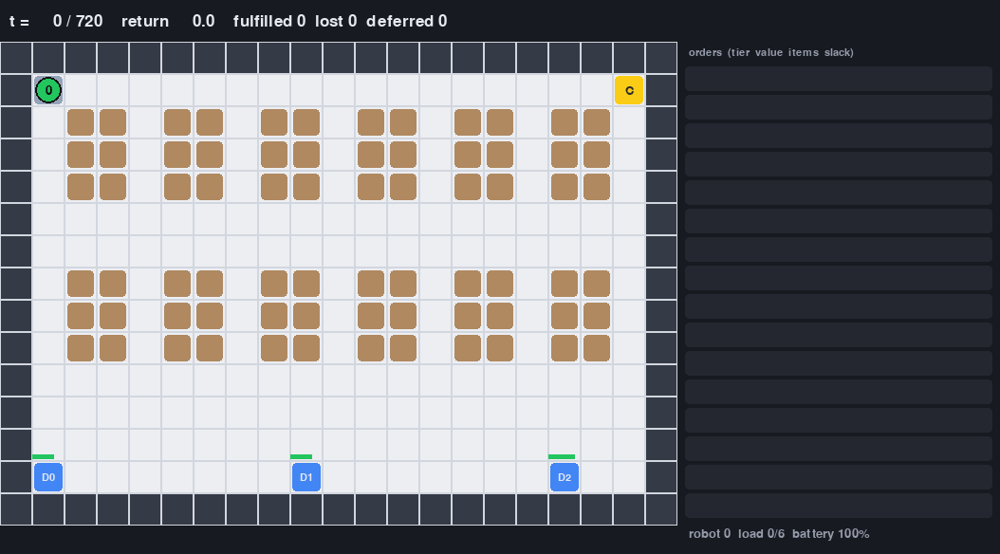
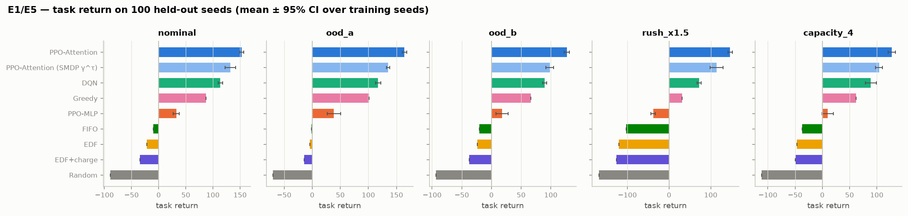
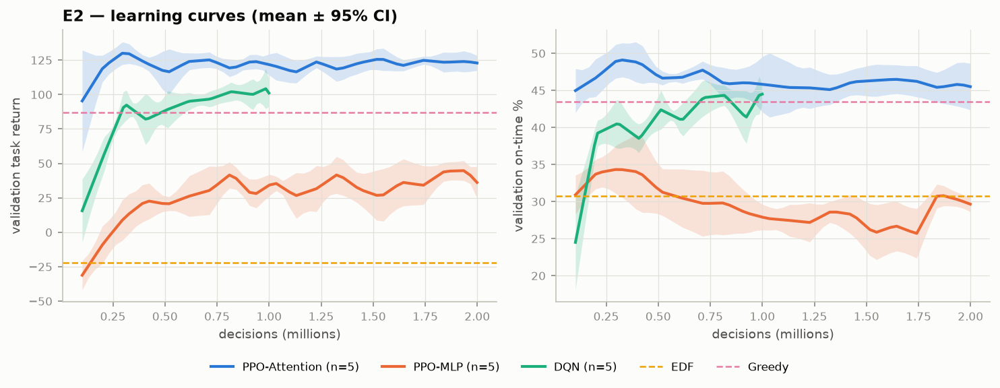
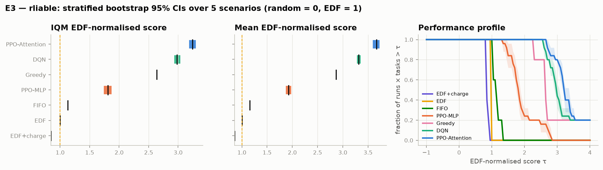
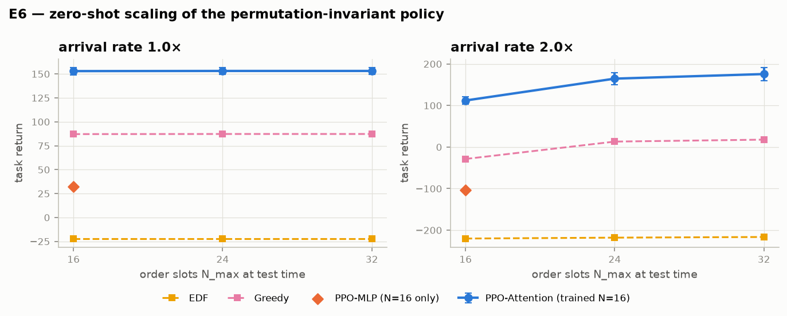
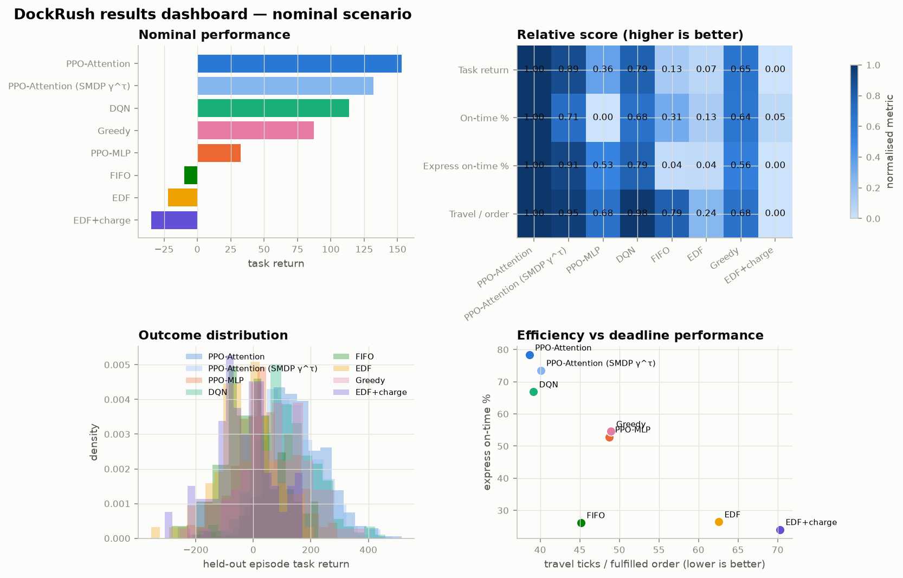
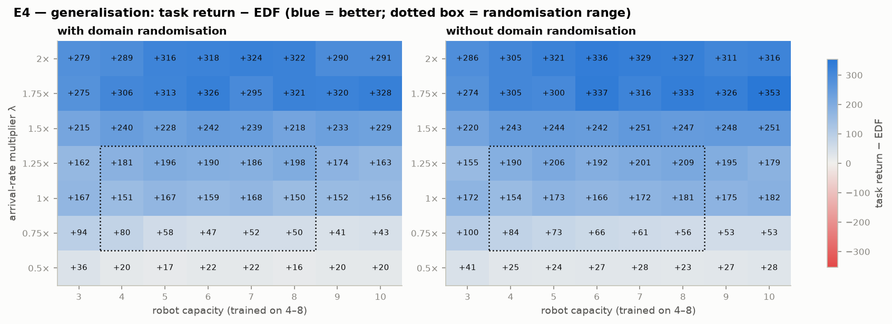
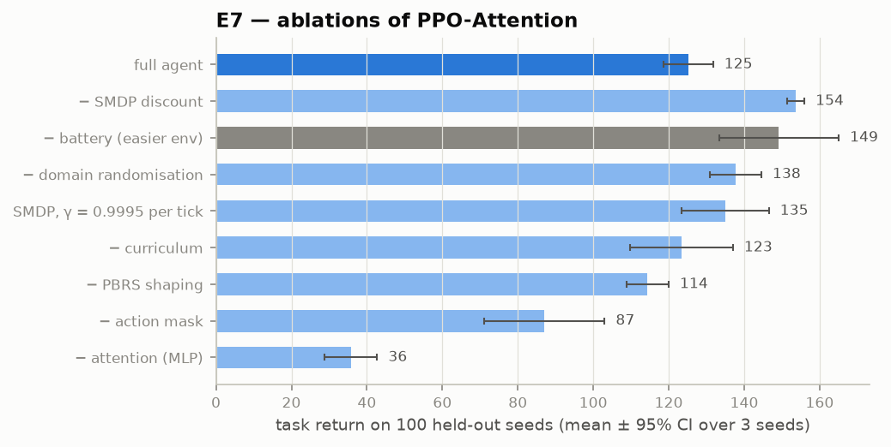
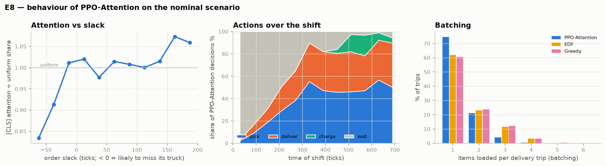
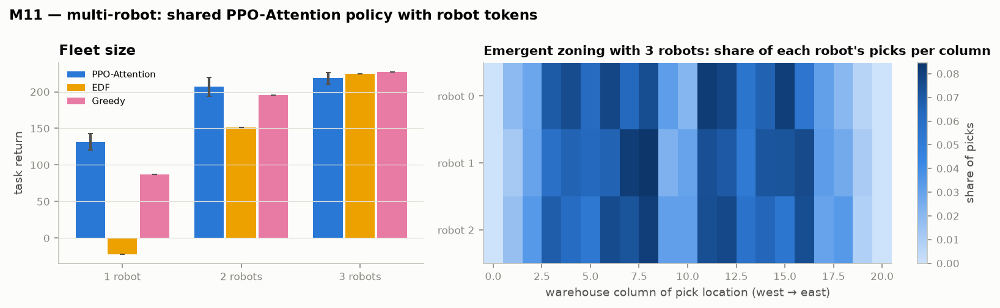

# DockRush

**Deadline-aware warehouse order fulfilment with attention-based PPO.**

[](https://github.com/Mohi1038/rl-warehouse-fulfillment/actions/workflows/ci.yml)
[](https://github.com/Mohi1038/rl-warehouse-fulfillment/releases)
[](https://github.com/Mohi1038/rl-warehouse-fulfillment)

A robot (or a fleet) picks orders that arrive stochastically through a shift and decides
*which order to work on next* under truck-departure deadlines, a carrying-capacity limit and
a battery. The decision-maker is a reinforcement-learning agent: PPO with a
permutation-invariant attention policy, trained in an event-driven semi-MDP simulator.
Rule-based policies (FIFO, EDF, Greedy) exist only as evaluation baselines.

**Interactive walkthrough:** [mohi1038.github.io/rl-warehouse-fulfillment](https://mohi1038.github.io/rl-warehouse-fulfillment/),
a scroll-driven site where every animation replays the real simulator and trained policy
(source in [site/](site/); see [Website](#website)).

### Watch the policies

| Learned policy | Value-based baseline |
|---|---|
|  |  |

The PPO animation includes the attention overlay: brighter purple shelf outlines indicate
where the policy is currently concentrating its order-selection attention. The Greedy
animation provides a direct visual baseline for the same warehouse and deadline mechanics.

## Headline results

Evaluated on 100 held-out seeds (disjoint from the validation seeds used to pick checkpoints);
± is a 95% CI over **5 training seeds**. *Task return* is the episode return without the
shaping term, so it is comparable across agents and ablations. Full tables:
[results/tables.md](results/tables.md).

| Agent (nominal scenario) | Task return | Revenue captured | On-time | Express on-time | Travel / order |
|---|---|---|---|---|---|
| **PPO-Attention** | **153.0 ± 3.9** | **67.3%** | **52.3%** | **78.3%** | 38.6 |
| PPO-Attention, original SMDP γ^τ | 132.0 ± 9.5 | 60.2% | 45.2% | 73.5% | 40.1 |
| DQN (same encoder) | 113.7 ± 4.2 | 58.8% | 44.3% | 66.9% | 39.2 |
| Greedy (value / distance) | 87.1 | 55.8% | 43.5% | 54.6% | 48.9 |
| PPO-MLP | 32.5 ± 5.7 | 38.2% | 27.6% | 52.8% | 48.7 |
| FIFO | −9.7 | 39.7% | 35.2% | 26.2% | 45.2 |
| EDF | −22.0 | 35.3% | 30.7% | 26.4% | 62.6 |
| Random | −89.1 | 19.0% | 14.1% | 10.6% | 77.2 |

- **PPO-Attention beats EDF and Greedy with a statistically significant margin** in every
  scenario: nominal, both unseen layouts, a 1.5× rush and capacity 4. rliable IQM of the
  EDF-normalised score (random = 0, EDF = 1) over 5 scenarios: **3.62 [3.58, 3.66]** vs the
  original SMDP-discounted agent 3.24 [3.18, 3.30], DQN 2.98 [2.93, 3.04] and Greedy 2.63.
  Probability of improvement: P(PPO-Attention > Greedy) = P(PPO-Attention > DQN) = 1.00.
- **Per-decision discounting is the biggest training improvement** (+21 task return, +7 points
  of revenue over the original agent); see [Improving the agent](#improving-the-agent).
- **Decision-time look-ahead lifts revenue past 70%.** Adding a planner over sampled futures to
  the same PPO checkpoint raises revenue captured from 66.4% to **71.0%**; see
  [Decision-time look-ahead](#decision-time-look-ahead).
- **Where the gain comes from:** express orders. It gets 78.3% of them on their truck,
  against 54.6% for Greedy, and needs 21% less travel per fulfilled order. EDF collapses under
  overload: it chases orders that are already lost, the classic EDF domino effect.
- **Attention matters.** The same PPO with a slack-sorted MLP reaches only 32.5. The
  attention policy also transfers to **unseen layouts** (ood_a 164.2 vs Greedy 101.3; ood_b
  126.9 vs 66.1).
- **Zero-shot scaling.** Trained with 16 order slots, the policy runs unchanged with 24 or
  32. At 2× the arrival rate, seeing more of the queue lifts it from 112 to 176 task return,
  while Greedy goes from −29 to 18 and EDF stays near −217.
- **Sanity check.** On the tiny instance, PPO reaches 100% and tabular Q-learning 94% of a
  clairvoyant hindsight-optimal search; the best heuristic reaches 91%.

| | |
|---|---|
|  |  |
|  |  |

### Results dashboard

The dashboard combines ranking, metric trade-offs, the held-out return distribution, and
deadline performance versus travel efficiency in one view:



### Visualization gallery

The repository includes a visual explanation of each part of the study:

| Topic | Visualization |
|---|---|
| Benchmark ranking and uncertainty | [E1/E5 benchmark](figures/e1_e5_benchmark.png) |
| Training stability | [Learning curves](figures/e2_learning_curves.png) |
| Statistical reliability | [rliable analysis](figures/e3_rliable.png) |
| Out-of-distribution behavior | [Generalisation heatmap](figures/e4_generalisation.png) |
| Larger queues and rush periods | [Zero-shot scaling](figures/e6_scaling.png) |
| What components matter | [Ablations](figures/e7_ablations.png) |
| How the policy behaves | [Behavior analysis](figures/e8_behaviour.png) |
| Fleet size | [Multi-robot scaling](figures/m11_multi_robot.png) |
| Small-instance optimality check | [Tiny environment](figures/m5_tiny_env.png) |

Interactive GitHub views are also available from the repository's
[Actions](https://github.com/Mohi1038/rl-warehouse-fulfillment/actions),
[commit history](https://github.com/Mohi1038/rl-warehouse-fulfillment/commits/main), and
[contributor graph](https://github.com/Mohi1038/rl-warehouse-fulfillment/graphs/contributors).

### Generalisation (E4)



PPO-Attention beats EDF in every cell of the λ ∈ [0.5, 2]× × capacity ∈ [3, 10] grid, well
outside the training range (grid computed with the original SMDP-discounted agent, the
configuration `abl_no_dr` was trained against). **Domain randomisation did not help here:** the agent trained
only on the nominal setting is as good or better across the grid. The observation already
carries capacity and an arrival-rate estimate, and slack features are normalised, so the
nominal policy extrapolates on its own.

### Ablations (E7)



Ablations were run against the **original SMDP-discounted agent**
([configs/ppo_attn_smdp.yaml](configs/ppo_attn_smdp.yaml)), not the current default. Each
variant is trained with 3 seeds at the same 2M-decision budget and compared with seeds 0–2 of
that agent (125.1 ± 6.6).

- **Attention is the biggest single factor** (−89 without it), then the **action mask** (−38:
  without it the policy wastes decisions on invalid actions that fall back to WAIT), then
  **PBRS** (−11).
- **The curriculum makes no measurable difference** (123.3 ± 13.6) once training reaches the
  nominal level. Removing the battery makes the task easier (149), as expected.
- **SMDP discounting hurt, so the default now uses a per-decision γ.** Discounting by `γ^τ` is
  the theoretically correct choice for a semi-MDP, yet replacing it with a per-decision γ
  scored best (153.7 ± 2.2). Per tick, γ = 0.995 gives a horizon of only ≈200 ticks (≈20 decisions),
  while per decision it spans the whole shift. Keeping `γ^τ` but raising γ to 0.9995 per
  tick (a whole-shift horizon) recovers about half the gap (134.9 ± 11.6). So the effective
  horizon explains part of it, and the rest is consistent with the lower variance of a
  constant per-step discount.

### Improving the agent

The ablation above led to a retrained main agent. Every variant is scored on the same 100
validation seeds (used to choose the default) and on the 100 held-out seeds (reported).
Full tables for all 5 scenarios: [results/variants.md](results/variants.md).

| Variant | seeds | Validation | Held-out task return | Revenue |
|---|---|---|---|---|
| Original: SMDP γ^τ, lr 3e-4, 20-episode validation every 25 updates | 5 | 104.7 ± 9.5 | 132.0 ± 9.5 | 60.2% |
| Per-decision γ | 5 | 135.8 ± 2.0 | 158.1 ± 5.7 | 67.5% |
| **+ lr 1.5e-4 (annealed), 50-episode validation every 10 updates (default)** | 5 | **140.9 ± 2.2** | 153.0 ± 3.9 | 67.3% |
| + d_model 128, 3 layers (518k parameters) | 3 | 139.6 ± 4.8 | 151.4 ± 1.2 | 67.2% |

- **The per-decision discount accounts for nearly all of the gain.**
- **The steadier schedule is a tie on held-out seeds** (it wins 3 of 5 scenarios, all within
  the confidence intervals). It was adopted because it scores highest on validation and has
  tighter seed-to-seed spread.
- **A 5× larger network does not help** at the same budget, consistent with learning curves
  that plateau early: model size is not the bottleneck.

### Decision-time look-ahead

[experiments/lookahead.py](experiments/lookahead.py) adds planning on top of the trained policy,
without any knowledge of the future. At each decision it simulates every valid action on K = 32
sampled futures and finishes each simulation with PPO. Orders that have not arrived yet and the
hidden departure jitter of trucks still at the dock are redrawn; everything the agent can observe
is kept. It executes the action with the highest mean revenue. All actions are scored on the
same samples.

| Best checkpoint, 100 held-out seeds | Revenue | Task return | On-time | Express on-time |
|---|---|---|---|---|
| PPO-Attention | 66.4% | 147.5 | 51.7% | 77.2% |
| **PPO-Attention + look-ahead** | **71.0% ± 2.5** | **164.4** | **54.6%** | 73.8% |
| Paired change | +4.6 ± 1.7 | +17.0 ± 13.4 | +2.9 ± 2.0 | −3.4 ± 3.8 |

- **The revenue gain is clear** and look-ahead does better on 72 of the 100 seeds.
- **Express on-time slips slightly** (within the noise): the planner maximises raw revenue,
  while PPO was trained on a reward that weights express orders 1.5×.
- **It costs compute:** about 3 s per decision on 10 cores, against milliseconds for PPO alone.
  This is PPO plus decision-time planning, not a faster policy.
- **Knowing the future is worth more:** on the first 20 seeds, with Greedy finishing the
  simulations, look-ahead given the true future reaches 72.0% against 63.1% with sampled futures.

Per-episode results: [results/lookahead_ppo_k32.json](results/lookahead_ppo_k32.json).

### Behaviour (E8)



- **Triage.** The [CLS] token gives express orders 2.0× their uniform attention share.
  Orders that are already likely to miss their truck (slack < −25 ticks) are picked next
  5% of the time, against 12% for orders with plenty of slack (> 50 ticks).
- **Batching like the heuristics.** 60% of its delivery trips carry a single item, close to
  EDF (62%) and Greedy (61%). The original SMDP-discounted agent made 75% single-item trips,
  loading items early instead of batching.
- **Charging** is spread across the shift instead of being left until after the midday peak
  as the original agent did.

### Multi-robot bonus (M11)



| Robots | PPO-Attention (shared policy) | Greedy | EDF |
|---|---|---|---|
| 1 | 131.6 ± 10.9 | 87.1 | −22.0 |
| 2 | **207.1 ± 12.9** | 195.1 | 151.5 |
| 3 | 218.6 ± 7.7 | 227.5 | 224.3 |

These runs use the original SMDP-discounted configuration. Two robots clearly beat one (+57%), and the shared asynchronous policy beats every heuristic
with one or two robots. With three robots the warehouse is no longer capacity-bound: every
policy fulfils most orders (PPO 87.5% on-time), and the learned policy is on par with
(slightly below) the heuristics. Order claiming prevents duplicate work. We did **not** observe
strong emergent zone-splitting: the three robots' pick locations cover the same columns with
similar shares.

## Quick start

```bash
python -m venv .venv && source .venv/bin/activate
pip install -r requirements.txt && pip install -e .

# evaluate the committed checkpoint against the baselines on 100 held-out seeds (+ GIF)
python evaluate.py --model models/best_ppo_attn.pt --agents edf greedy fifo random --episodes 100 --render

# train from scratch (≈18 min on a laptop CPU for 2M decisions)
python train.py --config configs/ppo_attn.yaml --seed 0
tensorboard --logdir runs

# reproduce every number and figure in this README
bash experiments/run_all.sh            # all algorithms × 5 seeds, ablations, multi-robot, figures
bash experiments/run_all.sh --quick    # minutes-long smoke test of the same pipeline
```

`pytest -q` runs the environment invariants and agent unit tests (≈10 s).

## The environment (`warehouse_env/`)

| | |
|---|---|
| **Layouts** | 21×15 grids from text files (`layouts/*.txt`): 54–72 shelves (obstacles picked from an adjacent aisle cell), 3 docks, a charger. `train_a`/`train_b` for training, `ood_a`/`ood_b` held out. All-pairs BFS distances are precomputed (`int16`). |
| **Time** | 1 tick = 1 cell; a shift is 720 ticks; picking takes 2 ticks/item, loading 1 tick/item. |
| **Orders** | Non-homogeneous Poisson arrivals by thinning, `λ(t) = λ_base(1 + 0.8 sin(2πt/T − π/2)) + spike(t)`: a quiet start, a midday peak and one random rush. 1–3 items from Zipf-weighted "hot" shelves; express 20% / standard 60% / bulk 20% with lognormal values (express ≈ 3× bulk); VIP shocks (5× value, tight deadline). |
| **Trucks** | 3 docks, departures every 120–180 ticks plus an end-of-shift truck. Departure jitter `N(0, 8)` is hidden: the agent sees only the scheduled time. On departure, fully loaded orders are fulfilled, express orders that missed are lost, standard/bulk orders are re-assigned to the next truck at half value. |
| **Robot** | Capacity 6 weight units; battery 400 (−1/tick moving, −0.2/tick working, +4/tick charging). A dead battery strands the robot: −50 and the episode is truncated. |
| **Actions** | `Discrete(21)` macro-actions: `PICK(i)` (nearest fitting item of order slot *i*), `DELIVER(d)`, `CHARGE`, `WAIT`. A state-dependent mask removes empty slots, items that do not fit, empty deliveries and any move that would leave too little battery to reach the charger; `WAIT` is always valid. |
| **Observation** | `global[16]` (time phase, battery, load, position, items carried per dock, time to each dock's next truck, backlog, arrival-rate estimate, capacity) + `orders[16, 14]` (value, tier, dock, slack, items left/carried, distance, fits, age) + `action_mask[21]`. More than 16 open orders wait in a backlog whose size is observed. |
| **Reward** | Per option of duration τ: tier-weighted revenue of fulfilled orders − lost express value − 0.3 × deferred value − 0.01 τ − 50 if stranded + potential-based shaping `α(γ^τ Φ(s′) − Φ(s))` with Φ = value of carried or dock-loaded items whose truck is still reachable. Every term is returned in `info["reward_terms"]`. |
| **Speed** | ≈18k decisions/s single-core; deterministic under a seed; passes `gymnasium.utils.env_checker`. |

The simulator is **event-driven**: the agent acts only when a robot becomes free, and between
decisions the clock advances by τ ticks while orders arrive and trucks leave (a semi-MDP with
options). Learners can discount each transition by `γ^τ`; the main PPO agent uses a constant
per-decision γ, which trained better (see the ablations). The same simulator runs `K`
robots asynchronously (whichever robot frees up next acts), which powers the multi-robot
bonus.

Registered ids: `DockRush-v0`, `DockRushTiny-v0`, `DockRushMulti-v0`. Curriculum levels
(`env.set_level`) and domain randomisation are config switches.

## Agents (`agents/`)

| Agent | File | What it is |
|---|---|---|
| **PPO-Attention (main)** | `ppo.py`, `ppo_attn.py`, `networks.py` | From-scratch PPO with a masked categorical, per-decision GAE by default (`smdp_discount: true` gives SMDP-correct `δ = r + γ^τ V′ − V`, trace `(γλ)^τ`), return normalisation, value clipping, KL early stop. Encoder: global MLP → [CLS] token, order MLP → tokens, 2-layer Transformer with padding mask; a **pointer head** scores each order slot, a small head scores DELIVER/CHARGE/WAIT. ≈99k parameters. Permutation-equivariant, so it runs with 24 or 32 order slots without retraining. |
| PPO-MLP | `ppo_mlp.py` | Same PPO, flatten + MLP over slots sorted by slack (an MLP is not permutation invariant). |
| DQN | `dqn.py` | Double + dueling DQN on the same attention encoder, sum-tree prioritized replay, 3-step returns discounted by `γ^{Στ}`, masked ε-greedy and masked target argmax. |
| Tabular Q | `q_learning.py` | SMDP Q-learning on the tiny env, checked against a clairvoyant hindsight-optimal search. |
| Baselines | `baselines.py` | Random, FIFO, EDF, Greedy (value / distance), EDF + charge-at-25%. Evaluation only; they read the same observation as the agents. |

**Training system.** YAML configs (`configs/`), one run = config + seed, TensorBoard logging of
losses, entropy, KL, explained variance, every reward term and every task metric. A
curriculum (`curriculum.py`) promotes through the plan's difficulty levels when the on-time
rate over 50 episodes exceeds 80% (with a fallback so training always reaches the nominal
level). Domain randomisation samples λ ∈ [0.6, 1.4]×, capacity ∈ {4…8} and jitter σ ∈ [0, 12]
per episode across both training layouts. The best checkpoint is selected on validation seeds
that are disjoint from the 100 held-out evaluation seeds (50 episodes every 10 updates for the
main agent, 20 every 25 for the others).

## Repository layout

```
warehouse_env/   env.py (event-driven SMDP), layout.py, orders.py, trucks.py, reward.py,
                 config.py, render.py (pygame + GIF), tiny_env.py, multi_env.py, layouts/
agents/          networks.py, ppo.py, ppo_attn.py, ppo_mlp.py, dqn.py, q_learning.py, baselines.py, common.py
train.py  evaluate.py  curriculum.py
configs/         base.yaml, ppo_attn.yaml, ppo_attn_smdp.yaml, ppo_mlp.yaml, dqn.yaml, tiny_q.yaml, tiny_ppo.yaml, multi_k{1,2,3}.yaml
experiments/     run_all.sh / run_all.py (resumable sweep), evaluate_all.py, compare_variants.py, lookahead.py, ablations.yaml
plots/           make_figures.py
models/          pretrained checkpoints (best_<algo>.pt and every seed of the main algorithms)
results/         evaluation JSON, tables.md, variants.md       figures/  all plots        assets/  GIFs
tests/           env invariants, determinism, generators, layouts, networks, GAE, replay, renderer
```

## Website

`site/` is a Vite + TypeScript site (GSAP ScrollTrigger, Lenis, D3) that explains the project
step by step: the warehouse, demand, the attention policy, discounting, a PPO vs baseline race,
look-ahead and the fleet. Its animations replay real episodes from held-out seed 100026,
exported by [experiments/export_site_data.py](experiments/export_site_data.py) into
`site/public/data/`.

```bash
python experiments/export_site_data.py --seed 100026   # regenerate the replay data (~2 min)
cd site && npm ci && npm run dev                         # local preview
```

Pushing changes under `site/` to `main` deploys it to GitHub Pages
([.github/workflows/pages.yml](.github/workflows/pages.yml)).

## Engineering

- **Invariants under test** for random and heuristic play, single/multi-robot, randomised and
  hardest-curriculum settings: capacity never exceeded, battery never negative, mask never
  all-false, Σ reward terms == reward (bit-exact), no order fulfilled twice, identical
  trajectories under the same seed, distance matrices symmetric with the triangle inequality,
  PBRS shaping equals `α(γ^τ Φ′ − Φ)`, arrival histograms match ∫λ(t).
- **CI** (`.github/workflows/ci.yml`): ruff, black, pytest, a one-minute PPO smoke run and an
  out-of-the-box evaluation of the committed checkpoint.
- Pinned `requirements.txt`, `Dockerfile`, type hints, `ruff` + `black`.
